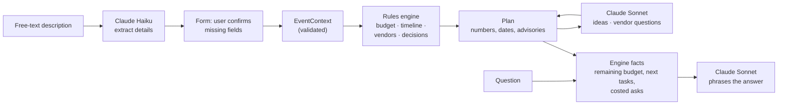

# Occasio

A planning assistant that turns a one-line description of an event into a complete, editable
plan: budget, timeline, vendor checklist, ideas, and an assistant that answers questions from
the plan's own numbers.

## Chosen vertical

**Event planning**: weddings, birthdays and community events, with defaults tuned for India
(INR, lakh notation, metro/city/town pricing).

## Idea in 5 lines

1. Describe your event in a sentence; Occasio fills in a form and asks only for what's missing.
2. A rules engine splits the budget, schedules milestones backwards from the date and lists the vendors to book.
3. It flags problems early: a tight budget, too little time, a missed milestone, an underfunded venue.
4. Claude adds personalised ideas and vendor questions that respect dietary and accessibility needs.
5. You lock budget lines, tick off tasks and ask "can I afford a live band?", and every answer comes from the plan's real numbers.

## Approach & logic

The central decision is a **hybrid engine**. Numbers must be correct, repeatable and testable,
so deterministic Python computes every amount, date and verdict. Language is where an LLM
shines, so Claude reads the user's description, writes ideas and questions, and phrases
answers, but **never invents a number**. It only sees facts the engine has already computed.



| Layer | Who does it | Why |
|---|---|---|
| Reading the description, clarifying | LLM (Haiku) | Natural language in, structured fields out |
| Budget split, dates, feasibility | Rules engine | Must be exact, repeatable, cheap and testable |
| Ideas, vendor questions, wording | LLM (Sonnet), JSON validated by Pydantic | Creativity and personalisation |
| Decisions ("venue too small for 40 guests") | Engine decides, LLM explains | Auditable logic |

Examples of engine rules: wedding venue booked at least six months out and invitations 8–10
weeks out; a kids' birthday gets no bar budget and more for entertainment; ticketed community
events reserve 10% contingency and more for permits; metro venues cost more; a short runway
compresses the timeline and marks what no longer fits as late. Details are in
[docs/architecture.md](docs/architecture.md); every number is listed in
[docs/assumptions.md](docs/assumptions.md).

## How it works

A walkthrough in mock mode (no API key), described screen by screen:

1. **Describe the event.** The first screen shows a large text box labelled "Describe your
   event". Typing *"I'm planning my sister's 30th for ~40 people in Pune, budget 1.5 lakh, in 6
   weeks"* and pressing **Help me fill the form** fills in the event-details form below it:
   Birthday, a date six weeks from today, 40 guests, ₹1,50,000, INR, Metro city, and age 30.
   A yellow box at the top of the form says *"We couldn't find these in your description: Style"*,
   and the Style field is outlined in amber with the note *"Not in your description – please fill
   this in."* Focus moves to that box so keyboard and screen-reader users hear it first.
2. **Create the plan.** After choosing *Semi-formal* and pressing **Create my plan**, the page
   shows *"Your birthday plan"* with a one-line summary (*3 Dec 2026 · 40 guests · ₹1,50,000 ·
   42 days to go*) and five tabs: Budget, Timeline, Vendors, Ideas, Advisories. The assistant
   panel sits beside the tabs on wide screens and below them on phones.
3. **Budget tab.** A table lists each category with an editable amount, its share, and a Lock
   checkbox. Venue shows ₹35,625 (23.75%) with the note *"Adjusted for metro venue prices"*.
   Changing Venue to 45,000 locks it, and the unlocked lines shrink so the total stays
   ₹1,50,000. A status message announces *"Venue set to ₹45,000 and locked; other lines
   rebalanced."*
4. **Timeline tab.** Milestones are grouped under month headings (*October 2026*, *November
   2026*…). Each row has a checkbox with the task name, its due date, and a status chip with an
   icon and a word: *○ To do*, *✓ Done* or *! Late*.
5. **Vendors tab.** One card per vendor (venue, catering, entertainment…) with a *Book by* date,
   suggested vendor types, a status menu (To do / Contacted / Booked) and an expandable
   *"Questions to ask (7)"* list.
6. **Ideas and Advisories tabs.** Ideas are cards tagged Theme, Menu, Activity, Decor or Gifting,
   with a **Suggest new ideas** button. For this birthday the Advisories tab says *"No issues
   found. Your plan looks workable."* A semi-formal wedding for 300 guests in Mumbai 30 days away
   on ₹5 lakh instead shows a count on the tab and three warnings, each with a suggested action:
   *"About 1,667 INR per guest is below the roughly 3,125 INR typical for a semi-formal wedding
   in a metro location"*, *"Only 30 days until the event; a wedding usually needs about 300, so
   the timeline has been compressed"*, and *"5 milestones are overdue: Set budget and guest
   list, Book venue, …"*.
7. **Ask the assistant.** Pressing the suggested question *"Can I afford a live band?"* adds the
   question and Occasio's reply to the conversation: *"live band: typically about 93750 INR, over
   budget by 71950.00 even after using contingency."* With an API key, Claude phrases the same
   engine facts as a natural answer.

### API

| Method | Path | Purpose | Rate-limited |
|---|---|---|---|
| `POST` | `/api/plans/intake` | Free text → extracted fields and the list of missing ones | Yes |
| `POST` | `/api/plans` | Event details → generated and stored plan (201) | Yes |
| `GET` | `/api/plans/{id}` | Plan, with overdue milestones and advisories updated for today | No |
| `PATCH` | `/api/plans/{id}` | Lock/unlock budget lines (rebalances), set milestone and vendor status | No |
| `POST` | `/api/plans/{id}/regenerate-ideas` | Fresh ideas from the LLM | Yes |
| `POST` | `/api/plans/{id}/chat` | Answer a question from engine-computed facts | Yes |
| `GET` | `/healthz` | Health check | No |

Interactive API docs are at `/docs` in development. Example:

```bash
curl -X POST localhost:8000/api/plans -H 'content-type: application/json' -d '{
  "event_type": "community", "event_date": "2026-12-20", "guest_count": 300,
  "total_budget": "200000", "location_tier": "metro", "formality": "casual",
  "extras": {"ticketed": false}, "dietary": ["vegetarian"], "accessibility_needs": ["wheelchair access"]
}'
```

## Running locally

Requires Python 3.11+ and `make`.

```bash
git clone https://github.com/krishna-nandan-yenuga/Occasio.git
cd Occasio
make install          # creates .venv and installs pinned dependencies
cp .env.example .env  # optional; the defaults run in mock mode
make dev              # http://localhost:8000
```

**Mock mode (default, no API key).** `LLM_PROVIDER=mock` uses a deterministic offline provider:
rule-based extraction plus canned ideas and questions per event type. Everything works,
including the tests.

**Anthropic mode.** Set these in `.env`:

```bash
LLM_PROVIDER=anthropic
ANTHROPIC_API_KEY=sk-ant-...
LLM_MODEL=claude-sonnet-5-5        # ideas, vendor questions, answers
LLM_CHEAP_MODEL=claude-haiku-5-5   # extracting details from text
```

Other settings: `DATABASE_PATH` (default `occasio.db`), `RATE_LIMIT_PER_MINUTE` (default 10,
per client IP, on LLM routes), `APP_ENV` (`dev` or `prod`; `prod` hides `/docs` and adds HSTS).

## Testing

```bash
make test        # 800+ tests, no network, no API key
make lint        # ruff check + format check
make typecheck   # mypy (strict on app/core)
make audit       # pip-audit on installed dependencies
make size-check  # fails if the repo or its history exceeds 9 MB
```

- **Engine** (`test_budget`, `test_timeline`, `test_vendors`, `test_decisions`, `test_models`):
  budgets sum exactly to the total across 540 combinations of type, formality, location, odd
  totals and guest counts; kids' parties have no bar; locked lines survive rebalancing;
  timelines compress and flag late work; community events always get permit and accessibility
  milestones; every engine is deterministic.
- **LLM layer** (`test_anthropic_provider`, `test_mock_provider`, `test_sanitize`): the real
  Anthropic SDK runs against a mocked HTTP transport, checking the request (model, schema,
  effort, fallbacks), retry-once-then-fail, refusals and API errors. Sanitising strips control
  characters and delimiter tags and flags injection phrasing.
- **Services, storage, API** (`test_planner_service`, `test_assistant`, `test_repo`,
  `test_ratelimit`, `test_api`): every route through the real app with `httpx.AsyncClient`,
  including validation errors, 404s, degraded LLM paths and 429 rate limiting.
- **Front end**: tests check the page is served with security headers, stays under 60 KB and
  uses no inline code, external assets or `innerHTML`. Accessibility was checked in Chrome with
  axe-core (see below).

## Security notes

- **Secrets**: the API key is read only from the environment or `.env`; `.env` is git-ignored and
  `.env.example` holds no values.
- **Input validation**: every request body is a Pydantic model that rejects unknown fields, with
  length limits (2,000 characters for free text, 200 per list item, 20 items per list).
- **Prompt injection**: user text is normalised, stripped of control and invisible characters and
  of any `<user_input>` tags, capped in length, then wrapped in `<user_input>` delimiters that the
  system prompt declares to be data. Suspicious phrasing is logged (by pattern name, never the
  text) rather than blocked. LLM output must match a JSON schema and is validated again by
  Pydantic.
- **Abuse**: routes that call the LLM are rate-limited per client IP (token bucket, 429 with
  `Retry-After`).
- **Browser**: strict Content-Security-Policy (`default-src 'self'`, no inline script or style),
  `X-Content-Type-Options: nosniff`, `X-Frame-Options: DENY`, `Referrer-Policy: no-referrer`,
  a Permissions-Policy, and HSTS in production. No CORS middleware, so the API is same-origin
  only. The UI inserts all text with `textContent`.
- **Storage**: parameterised SQL only; no `eval`, no shell.
- **Dependencies**: exact version pins; `make audit` runs `pip-audit`.
- **Access model**: there are no accounts. A plan is reachable by anyone who has its 128-bit
  random id, like an unlisted link.

## Efficiency notes

- The engine does the heavy lifting in microseconds; the LLM is called **at most twice per plan**
  (ideas and vendor questions, run concurrently with `asyncio.gather`) and **once per chat turn**.
- Cheap work goes to the cheap model: extraction uses Claude Haiku at low effort. Each call has a
  `max_tokens` cap (2k–8k) and an explicit effort level.
- Prompts are short: compact JSON of the event and the engine's facts only, with no ids,
  timestamps or past ideas.
- Editing the budget, ticking tasks and reading a plan never call the LLM.
- The front end is three static files (about 45 KB, 13 KB gzipped) with no framework or build.
- SQLite with a short-lived connection per operation; plans are single JSON documents.

## Accessibility notes

- Landmarks (`header`, `nav`, `main`, `footer`), a skip link, one `h1` and a logical heading order.
- Every input has a visible label. Missing and invalid fields are shown with a border, tint
  **and** text, listed in a summary that receives focus, and linked with `aria-describedby`.
- Status changes are announced through an `aria-live="polite"` region; the conversation is a
  `role="log"`. Focus moves to the plan heading after generation and stays on the same control
  after each edit.
- The plan sections are a WAI-ARIA tablist (arrow keys, Home and End). Budget is a real `<table>`
  with a caption and `scope` headers. Vendor questions use native `<details>`.
- Status is never colour alone: chips pair an icon with a word (*✓ Done*, *! Late*). Colours meet
  4.5:1 contrast in light and dark mode (`prefers-color-scheme`).
- `prefers-reduced-motion` turns off animation, transitions and smooth scrolling; the layout works
  at 360px wide; touch targets are at least 44px.

**Checking with axe.** Run `make dev`, open http://localhost:8000 with the
[axe DevTools](https://www.deque.com/axe/devtools/) browser extension, and scan each screen and
tab. During development the whole flow was also scripted in headless Chrome with axe-core 4.10:
0 violations on every screen and tab, in light and dark mode, at 360px and 1280px.

## Assumptions

Budget percentages, per-guest benchmarks, typical costs and timeline offsets are illustrative
defaults for the Indian market. INR is the default currency, and there is no live vendor data.
The full list is in **[docs/assumptions.md](docs/assumptions.md)**.

## Limitations & future work

- **Mock extraction is basic.** Without an API key, absolute dates ("on 8 Nov") and free-form
  needs ("wheelchair access", "veg-only") are not extracted; the form asks for them instead.
- **No actual spending.** The budget is a plan; recording quotes and payments would make
  "remaining budget" exact.
- **Ideas are regenerated as they are.** Changing preferences on the plan and caching ideas by
  event context (to make regeneration free for identical input) are not built yet.
- **The assistant costs only a handful of common asks** (band, DJ, magician, photographer,
  videographer, bar, extra guests). Others get the general plan facts.
- **Single process.** The rate limiter is in memory and SQLite is local, so horizontal scaling
  would need a shared store. Behind a proxy, run uvicorn with `--proxy-headers` so limits apply
  per real client.
- **No accounts or sharing controls**, no multi-day events, no languages other than English, and
  no live vendor marketplace.

## Project layout

```
app/
  main.py           app factory, security headers, static files, /healthz
  config.py         settings from environment
  api/              routes, dependencies, rate limiter
  core/             rules engine (pure, deterministic)
  llm/              provider protocol, Anthropic and mock providers, prompts, sanitising
  services/         plan generation and the assistant
  storage/          SQLite repository
  static/           index.html, styles.css, app.js
tests/              pytest suite
docs/               architecture.md, assumptions.md
```

## License

[MIT](LICENSE)
