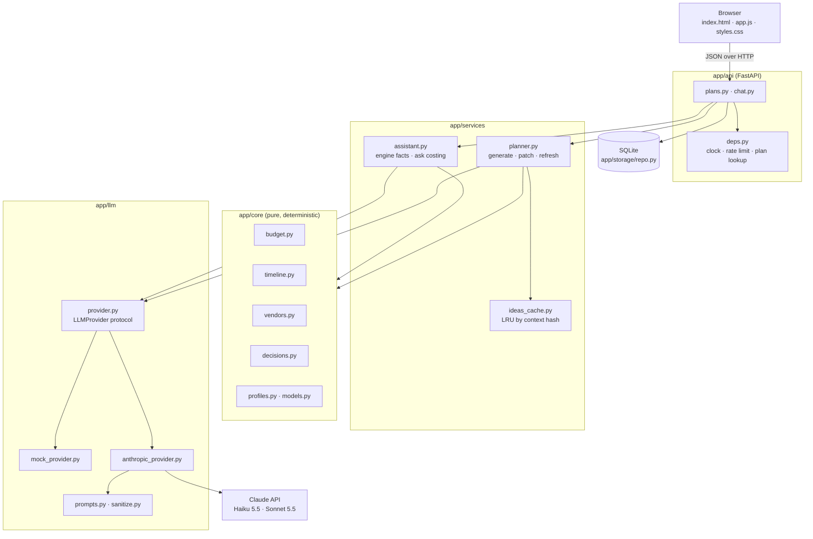
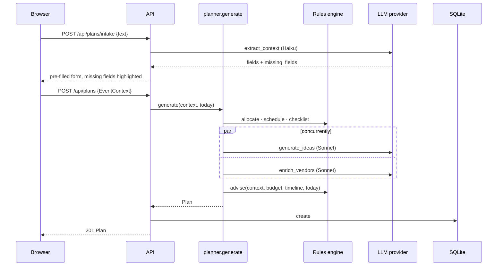

# Architecture

Occasio is one FastAPI process serving a JSON API and a static, build-free front end. The core
design choice is a **hybrid engine**: deterministic Python computes every number and date; the
LLM handles language (reading the user's description, writing ideas and questions, phrasing
answers) and never invents a figure.

## Layers

| Layer | Responsibility | Rules |
|---|---|---|
| `app/core` | Models, profiles, budget, timeline, vendors, decisions | Pure functions. No I/O, no clock, no randomness: `today` is always a parameter. Strict mypy. |
| `app/llm` | Talking to a language model | Every call returns JSON validated by Pydantic. User text is cleaned and wrapped in `<user_input>`. |
| `app/services` | Orchestration | Runs the engine, calls the LLM, merges, degrades gracefully. |
| `app/storage` | Persistence | One SQLite table; plans are JSON documents; parameterised SQL only. |
| `app/api` | HTTP | Validation, status codes, rate limiting, and the clock (`get_today`, `get_now`). |
| `app/middleware.py` | Every request | Security headers; 413 for bodies over 64 KB. |
| `app/static` | UI | Vanilla HTML/CSS/JS, no inline code, so it runs under a strict CSP. |

## Generating a plan

1. **Engine.** `allocate` splits the budget (profile table → location, guest-count, kids' party
   and ticketing adjustments → contingency fixed at 5–10% → rounding remainder to contingency).
   `schedule` dates the milestones backwards from the event, compressing them when time is
   short. `checklist` lists vendors with a book-by date taken from the timeline.
2. **LLM enrichment.** Ideas and extra vendor questions are requested at the same time with
   `asyncio.gather(..., return_exceptions=True)`, so one failing does not lose the other. Ideas
   come from the in-memory `IdeasCache` when the same context and budget were seen before.
3. **Advisories.** `decisions.advise` gathers budget feasibility, runway and overdue checks, plus
   cross-cutting rules (venue too small for the guest count, catering too thin, alcohol at a
   kids' party, unfunded permits or accessibility), sorted most severe first.

## Editing and asking

- **PATCH** locks or unlocks budget lines (`rebalance` spreads the rest of the total over
  unlocked lines in proportion), and sets milestone and vendor statuses. The plan is then
  refreshed: overdue milestones are marked late and advisories recomputed.
- **GET** returns the stored plan refreshed for today, without saving.
- **Regenerate ideas** optionally replaces the preferences, asks for new ideas and stores them in
  the cache; the budget and timeline are left as they are.
- **Chat**: `assistant.engine_facts` computes remaining budget, contingency, budget per guest,
  days to go, the next three milestones, late items and, for asks it recognises ("a live band",
  "10 more guests"), a costed verdict. Only these facts are given to the LLM for numbers.

## Failure handling

| Failure | Result |
|---|---|
| LLM returns invalid JSON or violates the schema | Retried once, then `LLMOutputError` |
| Model declines (`stop_reason: refusal`) | Sonnet calls use server-side fallbacks first; then `LLMOutputError` |
| API unreachable, auth or rate-limit error | `LLMUnavailableError` (the SDK has already retried 429/5xx) |
| Any `LLMError` while generating | Engine-only plan with advisory `LLM_UNAVAILABLE` |
| Any `LLMError` in intake or chat | `degraded: true`: an empty form to fill in, or a facts-only answer |
| Impossible budget edit or unknown item | 422, nothing saved |

## Data model

`Plan` = `id`, `context: EventContext`, `budget: [BudgetLine]`, `timeline: [Milestone]`,
`vendors: [VendorItem]`, `ideas: [Idea]`, `advisories: [Advisory]`, `created_at`, `updated_at`.
All models reject unknown fields. Plan ids are random 128-bit hex strings.
